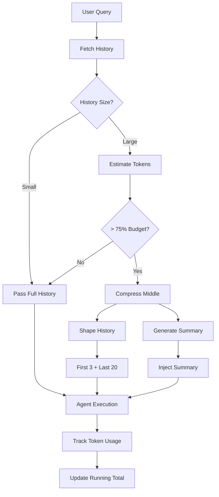

# Context Window 管理系统

## 概述

Shannon 实现了一套精细的、感知 token 的 context window 管理系统，使得类似 Claude Code 的长时调试 session 能够在 token budget 之内运行。该系统使用滑动窗口压缩，在数百轮对话之间保持对话连续性。

## 核心特性

### 1. 可配置的 Context Window
- **默认窗口**：50 条消息
- **调试预设**：75 条消息
- **硬性上限**：5-200 条消息
- **优先级顺序（当前实现）**：
  1. 请求级覆盖（`context.history_window_size`）
  2. 用例预设（`context.use_case_preset == "debugging"` → `HISTORY_WINDOW_DEBUG_MESSAGES`，否则回退为 75）
  3. 环境变量（`HISTORY_WINDOW_MESSAGES`）
  4. 以上都未提供时使用默认值（50）

注意：`shannon.yaml` 中存在用于默认值的强类型 config 字段，目前这些字段用于 budget 默认值。服务端的 history window 目前优先使用请求/环境变量，以便进行运维控制。

### 2. Token Budget 管理
- **每个 agent 的 budget**：默认 50,000 token
- **每个 task 的 budget**：默认 200,000 token（最大：200,000）
- **渐进式收敛（按 agent）**：环境变量 → 请求 context（可选）。强类型 config 为 BudgetManager 提供全局默认值；目前每个 agent 的收敛使用环境变量/context。
- **累计用量**：跟踪跨 agent 的累积用量
- **Budget 强制执行**：配置为硬上限（policy）时直接硬停止，否则按 budget manager 的配置走警告/背压/审批路径。

### 3. 滑动窗口压缩

当对话历史超过 token budget 的 75% 时，系统会自动：

```
Original: [500 messages] → Too large (100k+ tokens)
                ↓
Compressed: [First 3] + [Summary] + [Last 20] = Fits budget (~15k tokens)
```

**组成部分**：
- **Primers（可配置，默认 3）**：context 建立、初始需求
- **Summary（中间部分）**：中间消息的压缩语义摘要（已做 PII 脱敏）
- **Recents（可配置，默认 20）**：最近的对话 context

压缩会保留：
- 关键的初始化信息
- 关键决策与结果
- 最近的对话流程
- 错误消息与调试 context

### 4. Event 流与指标

#### 实时 Event
用户可以获得 context 管理的实时可见性：
- `"Preparing context"` - 初始 context 准备
- `"Found 5 past notes"` - memory 系统集成
- `"Shortened context to fit budget"` - 压缩已触发
- `"Previous context summary added"` - 摘要被显式注入
- `"Budget used: 14.8k/50k"` - token 用量跟踪

#### Prometheus 指标
- `shannon_compression_events_total{status=triggered|skipped|failed}` - 压缩 event 计数
- `shannon_compression_tokens_saved` - 每次压缩节省 token 数的直方图
- `shannon_compression_ratio` - 达到的压缩比的直方图

## 配置

### 环境变量

添加到 `.env` 或 export：

```bash
# Context Window Settings
HISTORY_WINDOW_MESSAGES=50              # Default context window size
HISTORY_WINDOW_DEBUG_MESSAGES=75        # Debugging preset window size

# Token Budget Clamping (optional)
TOKEN_BUDGET_PER_AGENT=50000           # Max tokens per agent
TOKEN_BUDGET_PER_TASK=200000           # Max tokens per task

# Compression thresholds (optional for testing/tuning)
# Trigger when estimated input ≥ ratio of budget/window
COMPRESSION_TRIGGER_RATIO=0.75         # Default 0.75
# Compress middle to this ratio of budget/window
COMPRESSION_TARGET_RATIO=0.375         # Default 0.375
```

### 配置文件

在 `config/shannon.yaml` 中：

```yaml
session:
  # Context window presets
  context_window_default: 50
  context_window_debugging: 75

  # Token budgets (guidance for planning/enforcement)
  token_budget_per_agent: 50000
  token_budget_per_task: 200000

  # Session management
  max_history: 500              # Max messages in Redis
  ttl: 720h                     # 30-day TTL

  # Compression tuning
  primers_count: 3              # Messages to keep at start (0-1000)
  recents_count: 20             # Messages to keep at end (0-1000)
```

### 请求级覆盖

通过 gRPC context 按请求覆盖：

```json
{
  "context": {
    "history_window_size": 100,           // Custom window size
    "use_case_preset": "debugging",       // Use debugging preset
    "token_budget_per_agent": 30000      // Custom agent budget
  }
}
```

## 工作原理

### 流程图



### 压缩算法

1. **触发**：估算 token 数 ≥ budget 的 75% 时
2. **提取**：取出中间消息（位于 primers 与 recents 之间）
3. **压缩**：通过 LLM 生成语义摘要
4. **注入**：以 `"Previous context summary: ..."` 形式加入
5. **整形**：返回前 3 条 + 后 20 条消息
6. **执行**：agent 收到整形后的 history 加摘要

### Token 估算

- **基础比率**：约每 token 4 个字符
- **每条消息开销**：格式化占 5 token
- **代码修正**：代码密集内容按每 token 3 个字符
- **安全余量**：+10% 缓冲

公式：`tokens = (total_chars / 4) + (message_count * 5)`

## 使用示例

### 标准用法

```bash
# Regular conversation (50 messages)
./scripts/submit_task.sh "Debug my authentication flow"

# Debugging preset (75 messages)
grpcurl -plaintext -d '{
  "metadata": {"userId":"dev","sessionId":"debug-session"},
  "query": "Fix the race condition in worker pool",
  "context": {"use_case_preset": "debugging"}
}' localhost:50052 shannon.orchestrator.OrchestratorService/SubmitTask
```

### 长时运行的 Session

```bash
# Create a session for extended debugging
SESSION_ID="debug-$(date +%s)"

# Multiple iterations will trigger compression automatically
for i in {1..100}; do
    SESSION_ID="$SESSION_ID" ./scripts/submit_task.sh \
        "Iteration $i: Debug the memory leak in connection pool"
done

# Events you'll see:
# - "Preparing context"
# - "Shortened context to fit budget"
# - "Previous context summary added"
# - "Budget used: 45.2k/200k"
```

### 带 Budget 控制的多 Agent

```bash
# Complex task with multiple agents
grpcurl -plaintext -d '{
  "metadata": {"userId":"dev","sessionId":"complex-task"},
  "query": "Analyze codebase, identify bottlenecks, and optimize performance",
  "context": {
    "force_p2p": true,
    "token_budget_per_agent": 30000
  }
}' localhost:50052 shannon.orchestrator.OrchestratorService/SubmitTask

# Each agent receives:
# - Shaped history (first 3 + last 20)
# - Previous context summary
# - Budget cap of 30k tokens
```

## 性能特征

### 压缩效果

| 场景 | 原始 | 压缩后 | 减少比例 |
|----------|----------|------------|-----------|
| 50 条消息 | ~10k token | 不压缩 | 0% |
| 100 条消息 | ~25k token | ~12k token | 52% |
| 500 条消息 | ~125k token | ~15k token | 88% |
| 1000 条消息 | ~250k token | ~15k token | 94% |

### 延迟影响

- **压缩开销**：生成摘要需要 200-500ms
- **Token 估算**：<5ms
- **History 整形**：<1ms
- **总体影响**：压缩路径约 500ms

### 内存占用

- **Redis 存储**：每个 session 最多 500 条消息
- **内存中**：仅整形后的 history（最多 23 条消息）
- **摘要 cache**：存放在 workflow context 中

## 最佳实践

### 1. Session 管理

```bash
# Use consistent session IDs for related work
SESSION_ID="feature-xyz-debug"

# Group related debugging sessions
SESSION_ID="$SESSION_ID" ./scripts/submit_task.sh "Debug issue A"
SESSION_ID="$SESSION_ID" ./scripts/submit_task.sh "Related to A: check B"
```

### 2. Budget 优化

```yaml
# For debugging: larger windows, higher budgets
context_window_debugging: 100
token_budget_per_agent: 75000

# For simple Q&A: smaller windows, lower budgets
context_window_default: 30
token_budget_per_agent: 25000
```

### 3. 监控

#### Event 监控
关注以下 event 以理解系统行为：
- 压缩频率过高 → 考虑增大基础窗口
- Budget 超限错误 → 提高每个 agent 的 budget
- Context 质量差 → 调整 primer/recents 数量

#### 指标监控
```bash
# Check compression effectiveness via metrics
curl http://localhost:2112/metrics | grep shannon_compression
```

## 技术细节

### 实现文件

- **配置**：`go/orchestrator/internal/config/shannon.go`
- **History 获取**：`go/orchestrator/internal/server/service.go:267-322`
- **滑动窗口**：`go/orchestrator/internal/workflows/helpers.go`
- **压缩逻辑**：`go/orchestrator/internal/workflows/simple_workflow.go`
- **Budget 分配**：`go/orchestrator/internal/workflows/supervisor_workflow.go`
- **消息辅助函数**：`go/orchestrator/internal/activities/stream_messages.go`

### 确定性要求

- 压缩工作在 activity 内运行；workflow 只负责调度 activity
- event 仅通过 activity 发出
- 新增的整形/压缩路径在 `context_compress_v1` 版本门控之下

### 隐私注意事项

- event 中不包含原始消息内容（仅元数据）
- 摘要写入存储前会过滤 PII（邮箱、电话号码脱敏）
- 压缩仅在服务端进行
- token 计数是估算值，而非精确值
- 摘要注入前会尽力做 PII 掩码

## 故障排查

### 问题：Context 似乎被截断

**症状**：agent 的回复表明 context 有缺失

**解决办法**：
1. 增大 `HISTORY_WINDOW_MESSAGES`
2. 使用调试预设：`"use_case_preset": "debugging"`
3. 在日志中检查压缩 event

### 问题：Token budget 超限

**症状**：出现「Budget exceeded」错误

**解决办法**：
1. 设置 `TOKEN_BUDGET_PER_AGENT` 环境变量
2. 提高 config 中的 `token_budget_per_task`
3. 启用压缩（本应自动生效）

### 问题：压缩未触发

**症状**：指标或日志中没有压缩 event

**解决办法**：
1. 降低 context 中的 `token_budget_per_agent` 以强制触发压缩（例如测试时设为 1000）
2. 确保 history 超过 20 条消息（压缩检查的最低要求）
3. 检查估算 token 数是否超过 budget 阈值的 75%
4. 对于 P2P workflow，压缩在 SupervisorWorkflow 中触发
5. 对于简单 task，压缩在通过版本门控后于 SimpleTaskWorkflow 中触发

### 问题：压缩过于激进

**症状**：重要 context 在摘要中丢失

**解决办法**：
1. 调整 `config/shannon.yaml` 中的 `primers_count`（默认：3）
2. 增大 config 中的 `recents_count`（默认：20）
3. 通过 context 按请求覆盖：`"primers_count": 5, "recents_count": 30`
4. 修改压缩目标比率（默认：budget 的 37.5%）

## 未来增强

### 阶段 4（计划中）

- **用例预设**：针对不同场景的优化配置
- **自适应压缩**：根据内容类型动态调整阈值
- **质量指标**：跟踪压缩效果
- **语义重要性**：保留 primers/recents 之外的关键消息

### 考虑中

- 针对超长 session 的分层摘要
- 跨 session 的 context 共享
- 压缩质量评分
- 用户自定义的重要性标记

## 相关文档

- [多 Agent Workflow 架构](./multi-agent-workflow-architecture.md)
- [Streaming API](./streaming-api.md)
- [Budget Management](./budget-management.md)
- [Memory System](./memory-system.md)
