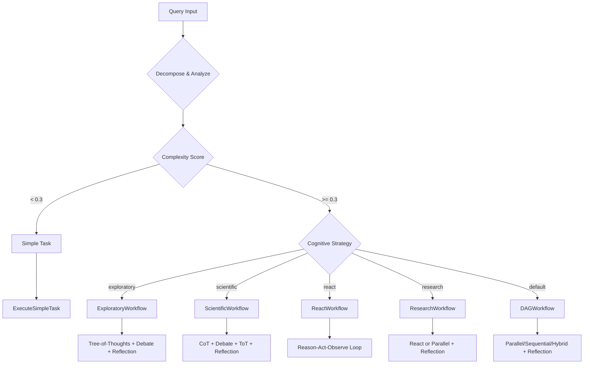

# 多 Agent Workflow 架构

## 概述

Shannon 实现了一套现代化的、基于 pattern 的多 agent workflow 系统，通过可组合的 pattern 支撑复杂的 AI 推理。该架构采用清晰的三层设计，在消除代码重复的同时，为复杂的 agent 编排提供灵活性。

## 架构分层

```
┌─────────────────────────────────────────────────────────┐
│                   Orchestrator Router                    │
│  (Query decomposition, complexity analysis, routing)     │
└─────────────────┬───────────────────────────────────────┘
                  │
┌─────────────────▼───────────────────────────────────────┐
│                  Strategy Workflows                      │
│  (DAG, React, Research, Exploratory, Scientific)         │
└─────────────────┬───────────────────────────────────────┘
                  │
┌─────────────────▼───────────────────────────────────────┐
│                   Patterns Library                       │
│  (Execution: Parallel/Sequential/Hybrid)                 │
│  (Reasoning: React/Reflection/CoT/Debate/ToT)           │
└─────────────────────────────────────────────────────────┘
```

## 核心组件

### 1. Orchestrator Router（`orchestrator_router.go`）
所有查询的入口，负责：
- **查询分解**：分析查询复杂度并拆分为子任务
- **复杂度评分**：判定查询是简单（< 0.3）还是复杂
- **Strategy 选择**：根据认知 strategy 路由到对应的 workflow
- **Budget 管理**：通过 middleware 强制执行 token 上限

### 2. Strategy Workflows（`strategies/`）
面向特定方法组合多个 pattern 的高层 workflow：

#### DAGWorkflow（`dag.go`）
- 处理通用 task 分解与多 agent 协同
- 支持并行、串行与混合（基于依赖）执行
- 应用 reflection pattern 提升质量

#### ReactWorkflow（`react.go`）
- 实现 Reason-Act-Observe 循环，用于迭代式问题求解
- 最适合需要 tool 调用与环境反馈的 task
- 维护观察窗口以保留 context

#### ResearchWorkflow（`research.go`）
- 针对信息收集与综合进行优化
- 简单研究使用 React pattern，复杂研究使用并行 agent
- 应用 reflection 获得更全面的结果

关于引用与校验的说明：当前行为与限制（citation prompt 的强制方式与 verification payload 内容）见 `docs/deep-research.md`。

#### ExploratoryWorkflow（`exploratory.go`）
- 使用 Tree-of-Thoughts pattern 进行系统性探索
- 置信度低时 fallback 到 Debate pattern
- 应用 Reflection 做最终质量检查

#### ScientificWorkflow（`scientific.go`）
- 使用 Chain-of-Thought 生成假设
- 通过多 agent Debate 检验假设
- 使用 Tree-of-Thoughts 探索影响
- 使用 Reflection 做最终综合

### 3. Patterns Library（`patterns/`）
可复用、可组合的 pattern，用于定义 agent 行为：

#### 执行 Pattern（`execution/`）
- **Parallel**：带信号量控制的 agent 并发执行
- **Sequential**：逐步执行并传递结果
- **Hybrid**：基于依赖图的执行，带拓扑排序

#### 推理 Pattern
- **React**（`react.go`）：集成 tool 的 Reason-Act-Observe 循环
- **Reflection**（`reflection.go`）：通过自我评估迭代提升质量
- **Chain-of-Thought**（`chain_of_thought.go`）：逐步推理并跟踪置信度
- **Debate**（`debate.go`）：多 agent 辩论以探索不同视角
- **Tree-of-Thoughts**（`tree_of_thoughts.go`）：带分支与剪枝的系统性探索

## Pattern 组合

workflow 通过组合多个 pattern 来实现复杂推理：

```go
// Example: Scientific Workflow Composition
1. Chain-of-Thought → Generate hypotheses
2. Debate → Test competing hypotheses
3. Tree-of-Thoughts → Explore implications
4. Reflection → Final quality synthesis
```

## Workflow 选择逻辑



## 配置

### Pattern 配置项

每个 pattern 都通过专属的 config struct 支持配置：

```go
// Example: TreeOfThoughtsConfig
type TreeOfThoughtsConfig struct {
    MaxDepth          int     // Maximum tree depth
    BranchingFactor   int     // Number of branches per node (2-4)
    EvaluationMethod  string  // "scoring", "voting", "llm"
    PruningThreshold  float64 // Minimum score to continue branch
    ExplorationBudget int     // Max total thoughts to explore
    BacktrackEnabled  bool    // Allow backtracking to promising branches
    ModelTier         string  // Model tier for thought generation
}
```

### Workflow 配置

workflow 通过 `activities.WorkflowConfig` 进行配置：
- `ExploratoryMaxIterations`：最大探索轮数
- `ExploratoryConfidenceThreshold`：目标置信度
- `ScientificMaxHypotheses`：生成的假设数量
- `ScientificMaxIterations`：最大检验轮数

## Token Budget 管理

所有 workflow 都通过以下方式遵守 token budget：
1. **Middleware**：`middleware_budget.go` 强制执行上限
2. **Pattern Options**：pattern options 中的 `BudgetAgentMax` 字段
3. **Activity Budgets**：使用 `ExecuteAgentWithBudgetActivity` 实现受控执行

## 最佳实践

### 各 Workflow 的适用场景

| Workflow | 适用场景 | 示例查询 |
|----------|----------|----------|
| **Simple** | 直接提问、单步 task | 「法国的首都是哪里？」 |
| **DAG** | 子任务明确的多步 task | 「构建一个带认证的 REST API」 |
| **React** | 需要调用 tool、迭代求解的 task | 「调试这段 Python 代码」 |
| **Research** | 信息收集与对比 | 「对比 React 与 Vue 框架」 |
| **Exploratory** | 开放式探索、解空间未知 | 「我们如何优化数据库？」 |
| **Scientific** | 假设检验、系统性分析 | 「验证 cache 能否带来 50% 的性能提升」 |

### Pattern 选择指南

1. **使用 Reflection**：当质量比速度更重要时
2. **使用 Chain-of-Thought**：面向需要显式推理步骤的问题
3. **使用 Debate**：当多视角能让答案更充分时
4. **使用 Tree-of-Thoughts**：面向有多条解路径的复杂问题
5. **使用 React**：当需要环境反馈时

### 组合策略

1. **从简开始**：先使用单个 pattern，再进行组合
2. **逐步叠加**：根据置信度阈值添加 pattern
3. **监控 token**：复杂组合的开销可能很高
4. **实证测试**：度量每个 pattern 带来的质量提升

## 扩展点

### 新增 Pattern

1. 在 `patterns/` 下创建 pattern 文件
2. 按标准签名实现 pattern 函数：
   ```go
   func YourPattern(ctx workflow.Context, query string, context map[string]interface{},
                    sessionID string, history []string, config YourConfig, opts Options) (*YourResult, error)
   ```
3. 在 pattern registry 中注册（可选）
4. 在现有或新的 strategy workflow 中组合使用

### 新增 Strategy

1. 在 `strategies/` 下创建 strategy 文件
2. 实现 workflow 函数：
   ```go
   func YourWorkflow(ctx workflow.Context, input TaskInput) (TaskResult, error)
   ```
3. 按需组合 pattern
4. 在 `orchestrator_router.go` 中添加路由逻辑
5. 在 `cognitive_wrappers.go` 中创建 wrapper 以兼容测试

## 子 Workflow

### 概述

子 workflow 是从父 workflow 内部调用的、独立的 Temporal workflow。它们让 workflow 组件可以模块化、可复用，在拥有自身生命周期的同时与父 workflow 保持连接。

### 何时使用子 Workflow

| 使用场景 | 理由 |
|----------|-----------|
| **可复用的领域逻辑** | 抽出可被多个父 workflow 调用的领域专属逻辑（例如公司研究） |
| **独立的 retry 策略** | 子 workflow 可以拥有自己的 retry 与超时设置 |
| **并行执行** | 并发启动多个子 workflow 以并行收集数据 |
| **Workflow 隔离** | 子 workflow 的失败不会拖垮父 workflow |
| **大结果处理** | 子 workflow 可以聚合结果并返回摘要 |

### 调用子 Workflow

使用 `workflow.ExecuteChildWorkflow()` 调用子 workflow：

```go
// 1. Define child workflow input
type DomainAnalysisInput struct {
    ParentWorkflowID    string              // For event propagation
    CanonicalName       string              // Company/entity name
    ResearchAreas       []string            // Areas to investigate
    TargetLanguages     []string            // Languages for search
    MaxPrefetchURLs     int                 // URL limit
    Context             map[string]interface{}
}

// 2. Define child workflow output
type DomainAnalysisResult struct {
    DomainAnalysisDigest string             // Structured markdown digest
    PrefetchURLs         []string           // URLs fetched for citations
    Stats                DomainAnalysisStats // Metrics (discovered, fetched, errors)
}

// 3. Invoke from parent workflow
func ResearchWorkflow(ctx workflow.Context, input TaskInput) (TaskResult, error) {
    // Configure child workflow options
    childCtx := workflow.WithChildOptions(ctx, workflow.ChildWorkflowOptions{
        WorkflowID:                   fmt.Sprintf("domain-analysis-%s", workflowID),
        TaskQueue:                    input.TaskQueue,
        WorkflowExecutionTimeout:     15 * time.Minute,
        WorkflowTaskTimeout:          time.Minute,
        ParentClosePolicy:            enums.PARENT_CLOSE_POLICY_REQUEST_CANCEL,
        WaitForCancellation:          true,
    })

    // Execute child workflow
    var domainResult DomainAnalysisResult
    err := workflow.ExecuteChildWorkflow(childCtx, DomainAnalysisWorkflow, DomainAnalysisInput{
        ParentWorkflowID: workflowID,
        CanonicalName:    refineResult.CanonicalName,
        ResearchAreas:    refineResult.ResearchAreas,
        TargetLanguages:  refineResult.TargetLanguages,
        MaxPrefetchURLs:  maxPrefetch,
        Context:          input.Context,
    }).Get(ctx, &domainResult)

    if err != nil {
        // Handle child workflow failure gracefully
        logger.Warn("Child workflow failed, continuing without domain data", "error", err)
    }

    // Use domainResult.DomainAnalysisDigest in synthesis...
}
```

### 控制信号传播

子 workflow 应支持来自父 workflow 的 pause/resume/cancel 信号。使用 control handler pattern：

```go
// In parent workflow - register child for signal propagation
controlHandler.RegisterChildWorkflow(childWorkflowID)
defer controlHandler.UnregisterChildWorkflow(childWorkflowID)

// In child workflow - handle signals
func DomainAnalysisWorkflow(ctx workflow.Context, input DomainAnalysisInput) (DomainAnalysisResult, error) {
    // Set up signal channels
    pauseCh := workflow.GetSignalChannel(ctx, "pause")
    resumeCh := workflow.GetSignalChannel(ctx, "resume")

    // Check for pause signals during long operations
    selector := workflow.NewSelector(ctx)
    selector.AddReceive(pauseCh, func(c workflow.ReceiveChannel, more bool) {
        // Handle pause
    })
    // ...
}
```

### 示例：DomainAnalysisWorkflow

`DomainAnalysisWorkflow` 是子 workflow pattern 的一个具体示例：

```
Parent: ResearchWorkflow
    │
    └─► Child: DomainAnalysisWorkflow
            │
            ├─► Phase 1: Discovery (web_search for official domains)
            │
            ├─► Phase 2: Prefetch (parallel web_subpage_fetch, max 5-15 URLs)
            │
            └─► Phase 3: Digest (LLM synthesis into structured evidence)
```

**输入/输出流向：**
- **Input**：公司名称、研究领域、语言偏好
- **Output**：结构化 digest（markdown）、已抓取的 URL（用于引用）、统计数据

**Source**：`go/orchestrator/internal/workflows/strategies/domain_analysis_workflow.go`

### 最佳实践

1. **始终传递 ParentWorkflowID**：使 SSE event 能流式推送到父 workflow 的客户端
2. **设置合适的超时**：子 workflow 的执行时间应当有界
3. **优雅处理失败**：即使子 workflow 失败，父 workflow 也应继续
4. **使用 ParentClosePolicy**：`REQUEST_CANCEL` 确保父 workflow 终止时完成清理
5. **限制子 workflow 嵌套**：避免深层嵌套（建议最多 2 层）
6. **返回摘要数据**：避免返回大量原始数据，在子 workflow 内完成汇总

## Reflection 门控

### 概述
Shannon 实现了智能 reflection 门控，在控制成本的同时优化质量。Reflection 会根据 task 复杂度自动触发。

### 配置
- **Threshold**：复杂度 > `ComplexityMediumThreshold` 的 task 会触发 reflection
- **默认值**：0.5（可在 `config/shannon.yaml` 中配置）
- **实现**：strategy helpers 中的 `shouldReflect()` 函数

### Reflection 触发时机
- 需要深度推理的复杂查询
- 带依赖关系的多步 task
- 需求不明确的 task
- 可按 workflow strategy 配置

## 监控与可观测性

### 指标
- 按类型统计的 workflow 启动/完成计数
- Pattern 使用频率
- 按 pattern 统计的 token 消耗
- 来自 reflection 的质量评分
- 来自推理 pattern 的置信度

### 日志
- 每一层的结构化日志
- Pattern 选择的依据
- 质量提升跟踪
- Token budget 消耗

### Temporal UI
- Workflow 可视化
- Activity 耗时
- Retry 跟踪
- 错误排查

## Human-in-the-Loop 审批

### 概述
Shannon 提供人工审批 workflow，用于需要在执行前接受监督的高风险操作。

### 触发条件
- **复杂度阈值**：复杂度评分 ≥ 0.7 的 task（可通过 `APPROVAL_COMPLEXITY_THRESHOLD` 配置）
- **危险 Tool**：使用 `file_system` 或 `code_execution` 等敏感 tool 的 task（可通过 `APPROVAL_DANGEROUS_TOOLS` 配置）

### 配置
```bash
# .env configuration
APPROVAL_ENABLED=true                                  # Enable approval workflow
APPROVAL_COMPLEXITY_THRESHOLD=0.7                      # Complexity threshold (0.0-1.0)
APPROVAL_DANGEROUS_TOOLS=file_system,code_execution   # Comma-separated list of tools
# NOTE: Approval timeout is currently set per-request via API input.
# The orchestrator's server default is 1800 seconds (30 minutes).
# An APPROVAL_TIMEOUT_SECONDS env var is not read by the server.
# To change the timeout, pass approval_timeout in the request payload.
# Example (not used by server):
APPROVAL_TIMEOUT_SECONDS=1800
```

### 审批流程
1. 触发后，workflow 暂停并生成 approval ID
2. 系统通过 HTTP endpoint 等待人工决定
3. 批准/拒绝可附带 feedback 消息
4. workflow 根据决定继续执行或终止

### API Endpoint
```bash
# Approve or deny a pending task via Gateway (recommended)
curl -X POST "http://localhost:8080/api/v1/approvals/decision" \
  -H "Content-Type: application/json" \
  -H "X-API-Key: your-api-key" \
  -d '{
    "approval_id": "<approval-id>",
    "workflow_id": "<workflow-id>",
    "approved": true,
    "feedback": "Approved for production deployment"
  }'

# Legacy admin endpoint (deprecated, use gateway instead)
# curl -X POST "http://localhost:8081/approvals/decision" ...
```

## 性能考量

### Token 效率
- 简单 task 绕过复杂 pattern
- 仅在质量低于阈值时触发 reflection
- 并行执行最大化吞吐
- cache 避免重复操作

### 可扩展性
- 由信号量控制的并行度（最多 5 个并发 agent）
- 感知依赖的调度
- 针对故障服务的熔断
- 高负载下优雅降级

## 迁移指南

### 从旧版 Workflow 迁移
1. 找出旧版 workflow 中的核心逻辑
2. 映射到合适的 pattern
3. 创建组合这些 pattern 的 strategy workflow
4. 为兼容性添加测试 wrapper
5. 更新 router 以使用新的 strategy
6. 删除旧版实现

### Pattern 重构
1. 把公共逻辑抽到 helper 函数
2. 创建带配置项的 pattern
3. 用 pattern 调用替换内联逻辑
4. 单独测试 pattern
5. 在 workflow 中组合使用

## 未来增强

### 计划中的 Pattern
- **Self-Consistency**：多条推理路径加投票
- **Least-to-Most**：由简到繁的问题分解
- **ReAct++**：带规划的增强 React
- **Constitutional AI**：价值对齐的推理

### 计划中的特性
- 基于查询分析的动态 pattern 选择
- Pattern 性能跟踪与自动调优
- 跨 pattern 的 context 共享
- 供社区贡献的 pattern marketplace

## 结语

Shannon 的多 agent workflow 架构为复杂的 AI 推理提供了灵活、可扩展的基础。通过组合可复用的 pattern，开发者无需重复代码即可构建强大的 workflow，同时保持清晰的关注点分离。

这种基于 pattern 的方法与现代框架（LangGraph、AutoGen、CrewAI）一致，让开发者对 Shannon 感到熟悉，同时通过基于 Temporal 的编排与完整的 pattern 库提供独特能力。
